# SAP MM Release Procedure - Configuration & Customizing

---

## 1. Business Purpose

This repository documents the end-to-end configuration of a **Release Procedure with Classification** in SAP S/4HANA Materials Management (MM). It outlines the customizing steps required to define evaluation criteria using characteristics (`CT04`), group them into a release class (`CL02`), and set up the approval workflow in `SPRO`—including release groups, release codes, release indicators, and release strategies.

---

## 2. Set Characteristic (CT04)

- **Transaction:** `CT04`
- **IMG Path (PR):** `SPRO` → *Materials Management* → *Purchasing* → *Purchase Requisition* → *Release Procedure* → *Procedure with Classification* → *Edit Characteristics*
- **IMG Path (PO):** `SPRO` → *Materials Management* → *Purchasing* → *Purchase Order* → *Release Procedure for Purchase Orders* → *Edit Characteristic*

### 2.1 Basic Data
- **Status:** Ensure the status is set to `1 Released`.
- **Value Assignment:** Select **Multiple Values**. In this case, it enables you to set the characteristic for more than one Purchasing Group (`P.Grp`) within a single release strategy.

> **Note:** The **Number of Chars** and **Data Type** fields at this step can be left empty—they will fill automatically from the ABAP Dictionary after you select the communication table reference on the *Addnl data* tab.

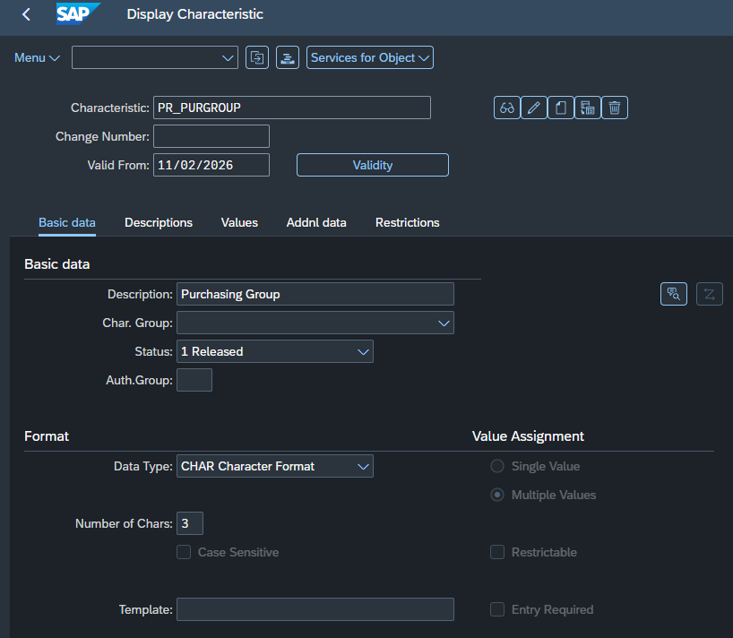

### 2.2 Description
- Maintain clear functional descriptions across the required system languages so the characteristic is easily identifiable on the strategy classification screens.

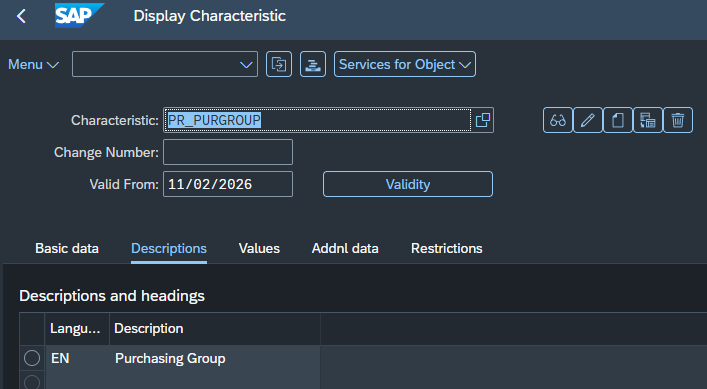

### 2.3 Values
- Enter the allowed characteristic values (e.g., specific Purchasing Groups like `K01`, `KE1`, `001`).

> **System Logic:** The values entered on this tab form the standard F4 search help dictionary. Merely listing values here does **not** activate them in a release strategy; specific triggering values must be explicitly selected later inside the strategy's *Classification* screen in `SPRO` (or `CL24N`).

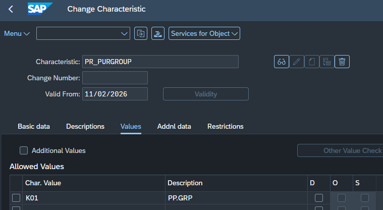

### 2.4 Additional Data (Addnl data)
- **Table Name & Field Name:** Link the characteristic to the underlying SAP communication structure.
- **Procedure for Value Assignment:** Check **Not Ready for Input** so the system automatically reads the value from the purchasing document and prevents manual overrides.

> **Note:** The most important communication structures in SAP MM are **`CEBAN`** (for Purchase Requisitions) and **`CEKKO`** (for external purchasing documents like Purchase Orders). Commonly evaluated technical fields include:
> - `EKGRP` – Purchasing Group
> - `BSART` – Document Type
> - `WERKS` – Plant
> - `MATKL` – Material Group
> - `GSWRT` – Total Value of Item (PR item-wise release)
> - `GFWRT` / `GNETW` – Total Net Value (Overall header release)

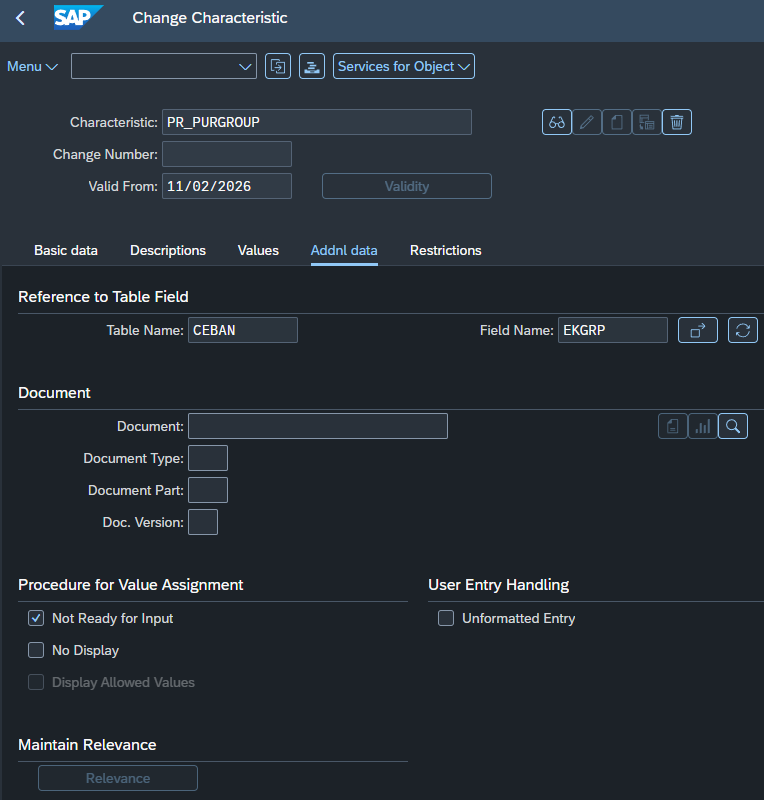

### 2.5 Restrictions
- **Class Type:** Restrict the characteristic exclusively to Class Type **`032`** (*Release Strategy*).

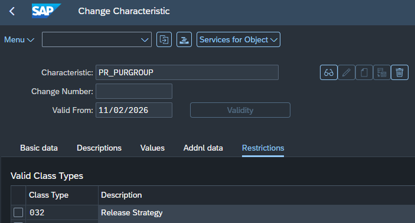

---

## 3. Set Up Class (CL02)

- **Transaction:** `CL02`
- **IMG Path:** `SPRO` → *Materials Management* → *Purchasing* → *Purchase Requisition* → *Release Procedure* → *Procedure with Classification* → *Edit Classes*

### 3.1 Basic Data
- Create a release class (e.g., `PR_CLASS` for Purchase Requisitions or `POREL` for Purchase Orders), assign it to **Class Type `032`**, and set the status to `1 Released`.

> **System Logic:** For Purchase Requisitions (Release Object `1`), a maximum of two classes can be used (one for item-wise release and one for overall header release). For Purchase Orders (Release Object `2`), SAP enforces a strict single-class constraint across the entire client (violation triggers error `ME492`).

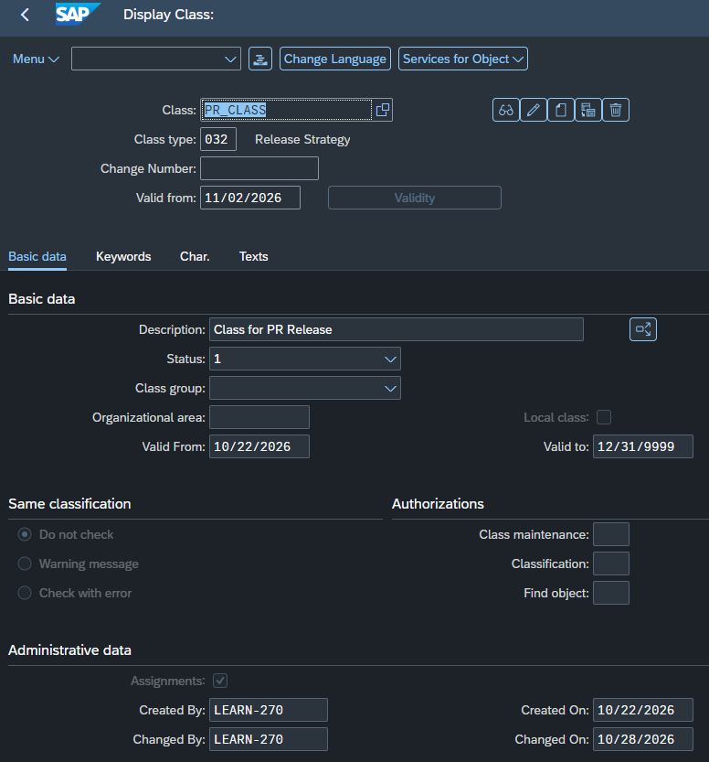

### 3.2 Characteristics Assignment (Char.)
- Navigate to the **Char.** tab and list all technical names of the characteristics created in Step 2.

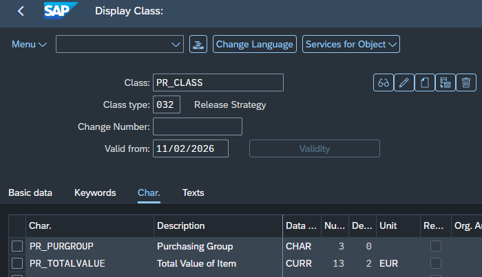

---

## 4. Set Up Procedure with Classification (SPRO)

- **IMG Path:** `SPRO` → *Materials Management* → *Purchasing* → *Purchase Requisition* → *Release Procedure* → *Procedure with Classification* → *Set Up Procedure with Classification*

### 4.1 A) Release Groups
- Define a 2-character **Release Group** (e.g., `Z1`) and link it to your Release Class (`PR_CLASS`).
- **Overall Release Flag (`OvRelPReq`):** Leave unchecked for item-wise release, or check it for header-level release (must match the `OvRelPReq` setting in *Define Document Types*).

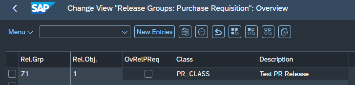

### 4.2 B) Release Codes
- Define 2-character **Release Codes** under your Release Group (e.g., `R8`, `P4`, `P3`) representing the individual approvers or organizational roles in the approval hierarchy (up to 8 codes per strategy).

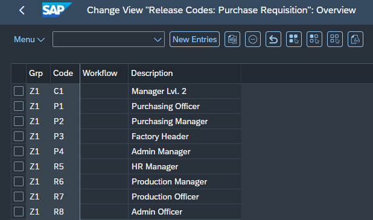

### 4.3 C) Release Indicators
- **Overview:** Release indicators denote the current processing status of the purchasing document during the approval cycle.

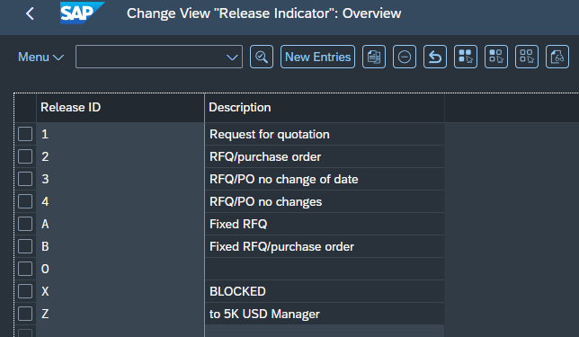

- **`2` (RFQ/PURCHASE ORDER – Final Released Status):** Check **Released for Quotation** and **Released for issue of PO** so follow-on documents can be generated once all approvals are complete.

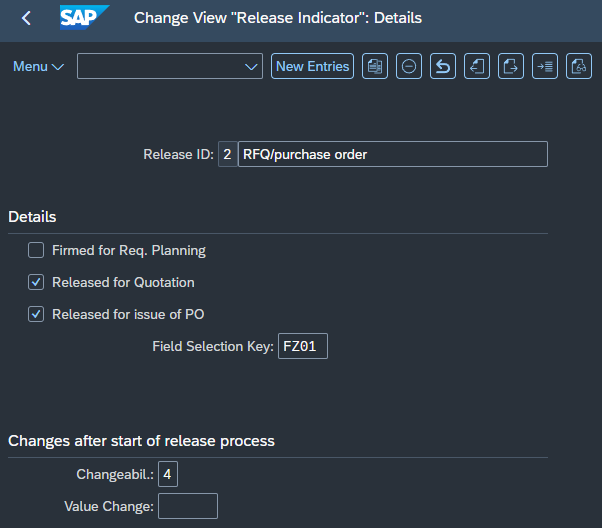

- **`X` (BLOCKED – Initial Blocked Status):** Keep the release checkboxes **unchecked** so the document remains blocked from conversion into a PO or RFQ while approvals are pending. Set the Changeability indicator (e.g., `4`) to control document editability.

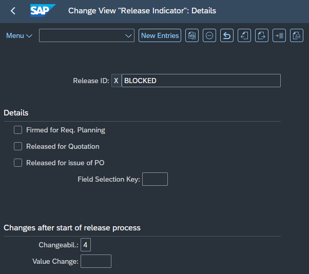

### 4.4 D) Release Strategies (`Z1` / `S1`)
- **Strategy Overview:** Create strategy `S1` under release group `Z1` and assign the required release codes in sequential order.

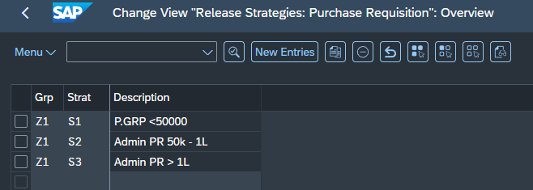

- **Strategy Details & Release Prerequisites:** Define the sequential approval order by checking the boxes in the prerequisite matrix.

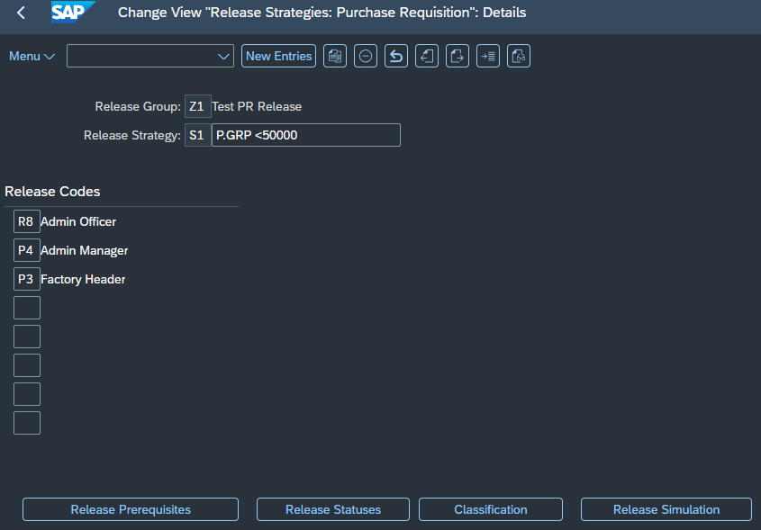
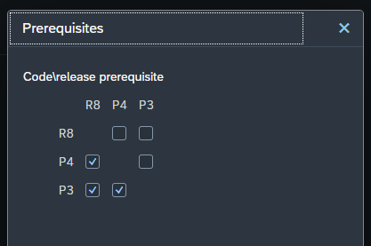

- **Release Statuses:** Map the `X` (*BLOCKED*) indicator to all unapproved or partially approved combinations, and assign the `2` (*RFQ/Purchase Order*) indicator only to the final row where all required codes are checked.

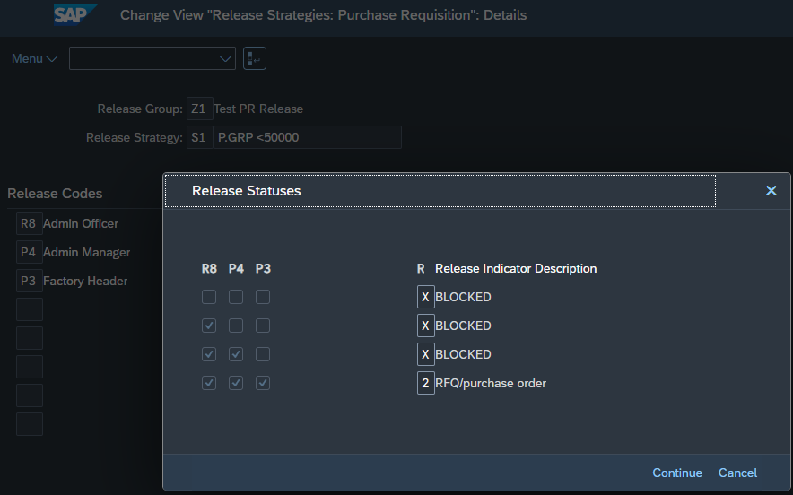

- **Classification:** Enter the exact characteristic values (e.g., Purchasing Group `K01` / `KE1` and value intervals) that trigger strategy `S1`.

> **Note:** SAP applies a strict logical `AND` across all characteristics in the class. Never leave an unused characteristic blank on the classification screen, as SAP interprets a blank entry as requiring the document field itself to be empty or `0.00`.

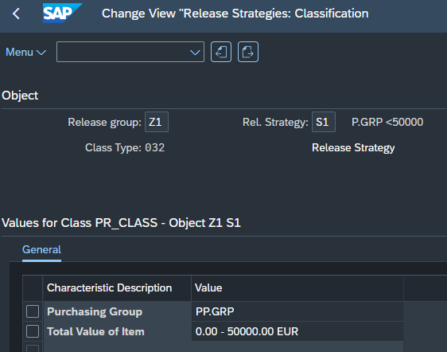

- **Release Simulation:** Execute the simulation tool to verify that sequential approvals transition the document status properly from `X` (*BLOCKED*) to `2` (*RFQ/Purchase Order*).

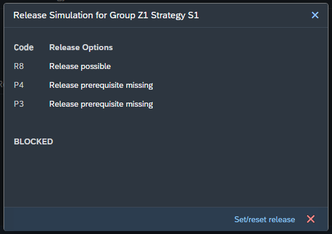